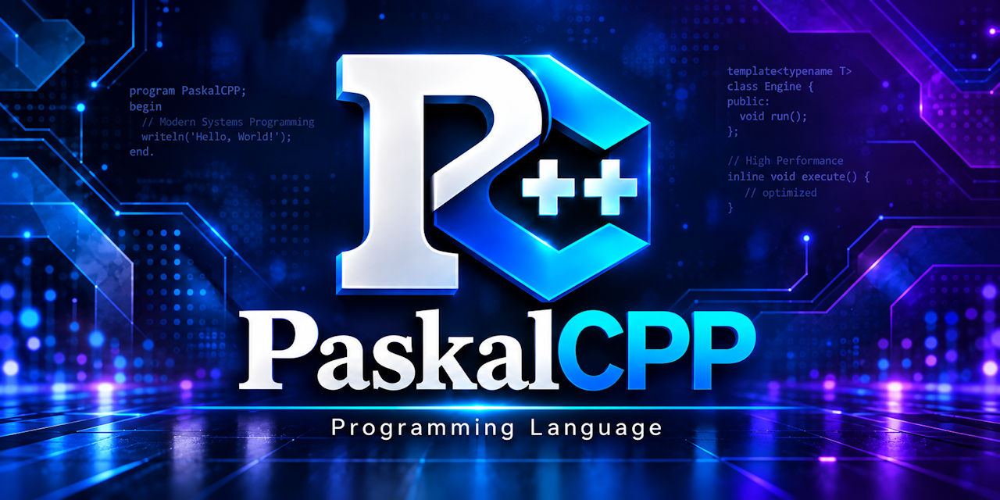

<!-- GENERATED by scripts\docs\gen_readme.py from docs\site\README.in.md: edit that file, then run the generator. -->

<p align="center">
  
</p>

<p align="center">
  <a href="https://discord.gg/Wb6z8Wam7p"></a>
  <a href="https://bsky.app/profile/tinybiggames.com"></a>
  <a href="https://www.facebook.com/groups/paskalcpp"></a>
</p>

<p align="center">
  <strong>Write Pascal-style code, use any C and C++ library.</strong>
</p>

<p align="center">
  <a href="https://paskalcpp.org">Homepage</a> ·
  <a href="https://paskalcpp.org/docs/index.html">Documentation</a> ·
  <a href="https://github.com/tinyBigGAMES/PaskalCPP/releases">Releases</a> ·
</p>

# PaskalCPP

PaskalCPP is a minimal, Pascal and Oberon inspired systems programming language that compiles to C++23 and mixes freely with C++ in the same source file, so every C and C++ library is available with no bindings.

## 🔥 What it is

PaskalCPP's syntax follows Pascal and Oberon: blocks open and close with words, assignment is `:=` and equality is `=`, every control-flow construct carries its own `end`, every statement ends with `;`, and names are declared before they are used.

The compiler writes a C++23 header and source for each module and builds them with the bundled Zig toolchain (clang) through `zig build`, which caches compiles. One source builds an executable (`module exe`), a shared library (`module dll`) or a static library (`module lib`), for x86_64-windows-gnu and x86_64-linux-gnu, from Windows.

C and C++ are part of the language. A library is used by `#include`-ing its header in the `.pcpp` file and calling it: there is no binding or wrapper layer. Its names are opaque to PaskalCPP and checked by clang. For the libraries PaskalCPP bundles, a vendor unit also sets up the include path, library path and link libraries on each target, so a program writes `import raylib;` and calls raylib's own API.

## 🚀 A first look

Here is `cpp_mixing_std.pcpp` (below):

`cpp_mixing_std.pcpp`: the C++ standard library used straight from PaskalCPP: a std::string and a std::vector as variables, their methods, std::sort, std::pow, and a C++ template written in the module and called from the PaskalCPP body. No binding anywhere: the headers are included.

```pcpp
module exe cpp_mixing_std;

#include <string>
#include <vector>
#include <cmath>
#include <algorithm>

template<typename T>
T Max2(T a, T b) {
  return a > b ? a : b;
}

var
  LS: std::string;
  LV: std::vector<int>;
  LD: float64;
  LX: int32;

begin
  LS := "hello world";
  if LS.find("world") <> std::string::npos then
    println("found at {}", LS.find("world"));
  end;

  LV.push_back(3);
  LV.push_back(1);
  LV.push_back(2);
  std::sort(LV.begin(), LV.end());
  println("sorted {} {} {}", LV[0], LV[1], LV[2]);
  println("size {}", LV.size());

  LX := 3;
  LD := std::pow(float64(LX), 2.0);
  LX := Max2(LX, int32(LD));
  println("max {}", LX);
end.
```

Output on x86_64-windows-gnu and x86_64-linux-gnu:

```text
found at 6
sorted 1 2 3
size 3
max 9
[Heap] Allocs: 0, Frees: 0, Leaked: 0
```


Build it and run it with one command:

```text
pcpp cpp_mixing_std.pcpp -r
```

With no `@optimize` a build is `debug`, and a debug build prints the runtime's heap report (the `[Heap]` line) when the program ends.

## ✨ Highlights

- **Readable by design.** Pascal and Oberon blocks, `:=` for assignment, `;` after every statement, each construct closed by its own `end`.
- **C++ is the surface.** `#include` a header and call it. A C++ type (`std::string`, `std::vector<int>`) can be the type of a PaskalCPP variable, and C++ declarations (a struct, a function, a template) stand at module level.
- **Errors speak PaskalCPP.** A mistake on a PaskalCPP construct is reported in PaskalCPP's words and types. What only C++ can judge is clang's or the linker's own message, mapped back to the `.pcpp` file, line and column.
- **The toolchain is in the box.** Zig and clang ship in the `res` folder beside `pcpp.exe`: one `pcpp` command turns a source file into a native binary.
- **Libraries in the box.** The standard library holds PaskalCPP's own units (`SysUtils`, `Math`, `Console`, `ResData`, `CustomIO`, `HookIO`, `HookABI`, `raylib_ext`, `rlimgui_ext`, `raven_raylib`, `sfml_ext`, `mojoal_ext`, `sqlite_ext`, `tmxlite_ext`, `ldtk_ext`) and vendor units for `box2d`, `cgltf`, `enet`, `flecs`, `glfw`, `ldtkloader`, `lua`, `miniaudio`, `minizip`, `mir`, `mojoal`, `pl_mpeg`, `pugixml`, `raven`, `raylib`, `rlgl`, `rlimgui`, `sdl3`, `sdl_gp`, `sfml`, `sqlite`, `tmxlite`, `yyjson`, `zlib`, `zstd` and fifteen stb libraries: `import sfml;` and the library is ready on both targets. The bundled examples (`res\examples`) build on both.
- **Two targets, one source.** `@target` or `pcpp -t` picks x86_64-windows-gnu or x86_64-linux-gnu; `pcpp <file> -r` runs a Linux build through WSL.

## 🛠️ Tools

- **`pcpp`**, the compiler: `pcpp <source> [OPTIONS]`; `pcpp -h` lists every option.
- **The PaskalCPP Editor** (`pcpp editor [files]`): an Electron application whose editing surface is Monaco, with build, run and debug.
- **A language server** (`pcpp --lsp`): the Language Server Protocol server the editor runs, and any LSP client can.
- **A debugger** for the x86_64-windows-gnu target: the console debugger (`pcpp <file> -d`) and the debug adapter (`pcpp --dap`) the editor runs, both on one engine.

## 📦 Getting PaskalCPP

Download the latest release from [GitHub Releases](https://github.com/tinyBigGAMES/PaskalCPP/releases). The documentation is online at [paskalcpp.org/docs](https://paskalcpp.org/docs/index.html) and ships in the release as `docs/html/index.html`; start with the [tour](https://paskalcpp.org/docs/tour.html).

## 🔧 Building from source

For contributors who want to change the compiler itself.

| | Requirement |
|---|---|
| **Host OS** | Windows x64 |
| **Compiler** | Delphi (RAD Studio) |
| **A release** | The latest [release](https://github.com/tinyBigGAMES/PaskalCPP/releases): the repo holds the sources only, and the Zig toolchain, the vendor libraries and every other binary come in the release |

1. **[Download ZIP](https://github.com/tinyBigGAMES/PaskalCPP/archive/refs/heads/main.zip)** or clone the repo:

   ```text
   git clone https://github.com/tinyBigGAMES/PaskalCPP.git
   ```

2. Download the latest release and unzip it into the repo folder, so the toolchain, the libraries and the binaries are in place. A build from source needs them too.
3. Run `bin\build-pcpp.cmd` (it loads RAD Studio's `rsvars.bat` from `Studio\37.0`: edit that line for another install), or open `projects\PaskalCPP.groupproj` in the Delphi IDE and build the `pcpp` project. This produces `pcpp.exe` in `bin\`. The test runner is not part of this release; it returns in a later update.

## ❓ FAQ

<details>
<summary><b>Every build fails with <code>ZB0016</code>: "unable to find zig installation directory"</b></summary>

The bundled Zig toolchain is incomplete. zig needs its `lib` folder beside `zig.exe`, and when `bin\res\zig\lib\std\std.zig` is missing every build fails with this message, which is zig's own.

To fix it:

1. Delete the `bin\res\zig` folder.
2. Extract the release zip again with 7-Zip or WinRAR.
3. Check that `bin\res\zig\lib\std\std.zig` exists.

</details>

<details>
<summary><b>The first build is slow</b></summary>

The first build for a target also compiles the libraries every program links (the C runtime, libc++, libc++abi, libunwind, compiler_rt and the system import libraries) and keeps them in zig's cache, `bin\res\zig\.zig-cache`. That build can take a few minutes.

Later builds for that target reuse them, at another optimize level too, and take seconds. The first build for the other target (x86_64-linux-gnu) compiles its own libraries once in the same way. Deleting `bin\res\zig\.zig-cache` makes the next build of each target slow again. How a build works is in [Building](https://paskalcpp.org/docs/build.html).

</details>

<details>
<summary><b>How do I load a library's files from <code>assets.zip</code>?</b></summary>

Mostly through `HookIO` (see [Standard library](https://paskalcpp.org/docs/stdlib.html)), which hands C's `fopen` a zip entry (an IO from `CreateZipFileIO`). Which way depends on the library:

- mojoAL, SQLite, tmxlite and LDtkLoader: their `_ext` unit has a `...Zip` load form that takes the archive, the entry and the password (`LoadSoundZip`, `OpenDatabaseZip`, `LoadTiledMapZip`, `LoadLdtkProjectZip`), and an IO form beside it. See [Vendor libraries](https://paskalcpp.org/docs/vendor.html).
- raylib: `raylib_ext`'s IO forms (`LoadTextureIO` and the rest) over `CreateZipFileIO`, or `SetRaylibIOSource` to make the zip raylib's file system. SFML: `sfml_ext`'s `sfx::ZipStream`.
- Lua and yyjson: register the entry with `RegisterIO` and pass its `io://` path to `luaL_loadfile` or `yyjson_read_file`; they open files with `fopen`, so no extension unit is needed.
- A SQLite database from a zip is read-only: SQLite opens files through its own layer, which HookIO does not reach, so `sqlite_ext` reads the entry into memory and hands it to `sqlite3_deserialize`.

The `...Zip` examples in `res\examples` each load from the shared `assets.zip`.

</details>

<details>
<summary><b>A Lua error skips my C++ destructors</b></summary>

Lua's errors are C `longjmp`s: `lua_error`, `luaL_error` and a failing `luaL_check*` jump out of the routine that calls them, past every C++ destructor between there and the `lua_pcall`. A routine Lua calls therefore checks its arguments first, before it makes anything that needs freeing (a `string`, a container, an object).

</details>

<details>
<summary><b>flecs' <code>ECS_COMPONENT</code> and <code>ecs_set</code> do not compile</b></summary>

They are flecs' C macros, built on C compound literals, which C++ rejects. Use flecs' C++ API instead (`flecs::world`, `world.entity().set<T>(...)`, `world.system<...>().each(...)`), with PaskalCPP records as components; `std\flecs.pcpp` documents how a routine is written as an `.each` callback.

</details>

<details>
<summary><b>An ENet server does not reach a client that just connected</b></summary>

Each side gets its own CONNECT event when it services its host, and the client's often comes first. The server reaches (and broadcasts to) only the peers whose CONNECT it has seen, so wait for that event on the server before sending to the new peer.

</details>

<details>
<summary><b>A Linux window opens small under WSL2, and the program reads a display scale of 1</b></summary>

A Linux build run on Windows (`-t x86_64-linux-gnu -r`) runs under WSL2, and its window is shown by WSLg, whose compositor (Weston) gives every Linux program a display scale of 1 by default. A program that sizes its window by that scale (the SDL3 examples call `SDL_GetWindowDisplayScale`) opens at 1x on a 150% monitor, smaller than the same program built for Windows.

To make WSLg follow each monitor's Windows scale, create the file `.wslgconfig` in your Windows user folder (`C:\Users\<you>\.wslgconfig` for WSL from the Microsoft Store; `C:\ProgramData\Microsoft\WSL\.wslgconfig` for the WSL built into Windows) holding:

```text
[system-distro-env]
WESTON_RDP_HI_DPI_SCALING=true
WESTON_RDP_FRACTIONAL_HI_DPI_SCALING=true
```

then run `wsl --shutdown` (WSLg reads the file when it starts). The Linux window then opens at the size Windows scales it to on that monitor. The program itself still reads a scale of 1: Windows enlarges the window, the program does not draw at the higher resolution.

Leave out `WESTON_RDP_DEBUG_DESKTOP_SCALING_FACTOR`: it forces one factor on every monitor instead of each monitor's own.

</details>

More answers are in the [FAQ](https://paskalcpp.org/docs/faq.html).

## 🤝 Contributing

- **Report bugs** with a minimal `.pcpp` reproduction, the exact command used, and the compiler's diagnostics.
- **Suggest features**: describe the use case first, then the behavior you have in mind.
- **Submit pull requests** for bug fixes, documentation, new test cases and well-scoped features; open an issue first for substantial language or compiler changes.
- **Review and discuss** open pull requests and issues.

Read [CONTRIBUTING.md](https://github.com/tinyBigGAMES/PaskalCPP?tab=contributing-ov-file) and the [Code of Conduct](https://github.com/tinyBigGAMES/PaskalCPP?tab=coc-ov-file) before you start. Bugs can also go through the [report page](https://paskalcpp.org/report/). Join the [Discord](https://discord.gg/Wb6z8Wam7p) to talk development, ask questions, or show what you are building. Contact: support [at] paskalcpp [dot] org.

## 💖 Support the project

If PaskalCPP saves you time, helps you learn, or sparks something useful:

- ⭐ **Star the repo**: it costs nothing and helps others find the project
- 📣 **Spread the word**: write a post, mention it in a community, or share a screenshot
- 💬 **Join the community**: show what you are building and help shape what comes next on [Discord](https://discord.gg/Wb6z8Wam7p) or in the [Facebook group](https://www.facebook.com/groups/paskalcpp)
- 🧪 **Build something real**: real usage finds issues that synthetic tests miss
- 💖 [**Become a sponsor**](https://github.com/sponsors/tinyBigGAMES): sponsorship directly funds development, examples, and documentation

## 📜 License

PaskalCPP is free and open source under the **Mozilla Public License 2.0**: see [LICENSE](https://github.com/tinyBigGAMES/PaskalCPP?tab=MPL-2.0-1-ov-file) and [NOTICE.md](NOTICE.md). The runtime and standard library files that PaskalCPP builds into your programs carry an additional permission: see [RUNTIME-EXCEPTION.md](RUNTIME-EXCEPTION.md). The PaskalCPP name and marks: [TRADEMARK.md](TRADEMARK.md).

## 🔗 Links

- 🌐 [Homepage](https://paskalcpp.org)
- 🐞 [Issues](https://github.com/tinyBigGAMES/PaskalCPP/issues)
- 📝 [Report an issue](https://paskalcpp.org/report/)
- 📖 [Documentation](https://paskalcpp.org/docs/index.html)
- 💬 [Discord](https://discord.gg/Wb6z8Wam7p)
- 🦋 [Bluesky](https://bsky.app/profile/tinybiggames.com)
- 👥 [Facebook Group](https://www.facebook.com/groups/paskalcpp)
- 🎮 [tinyBigGAMES](https://tinybiggames.com)

<div align="center">

**PaskalCPP**&#8482; Programming Language

Copyright &copy; 2026-present tinyBigGAMES&#8482; LLC  
All Rights Reserved.

</div>
